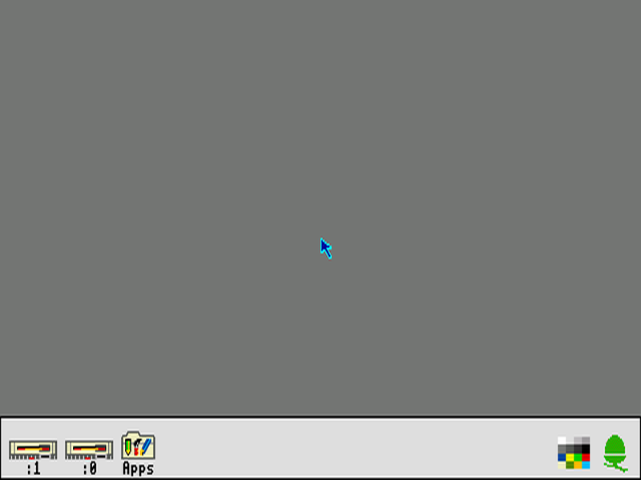
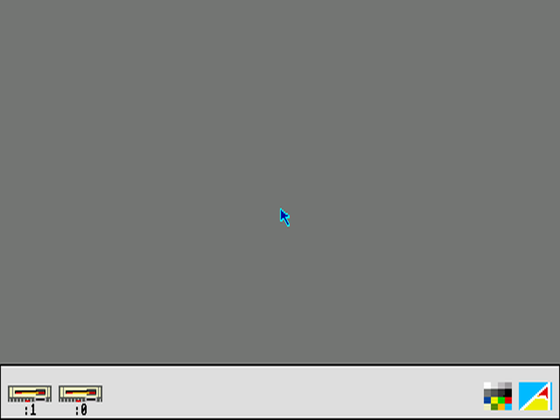
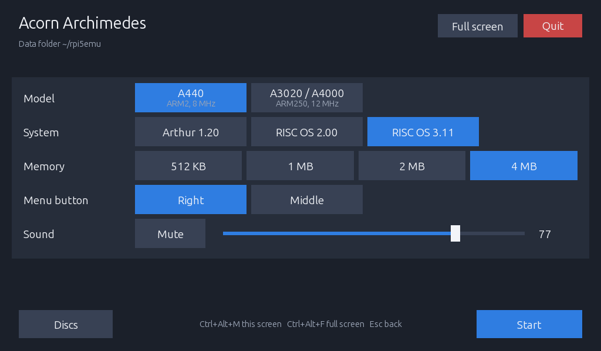
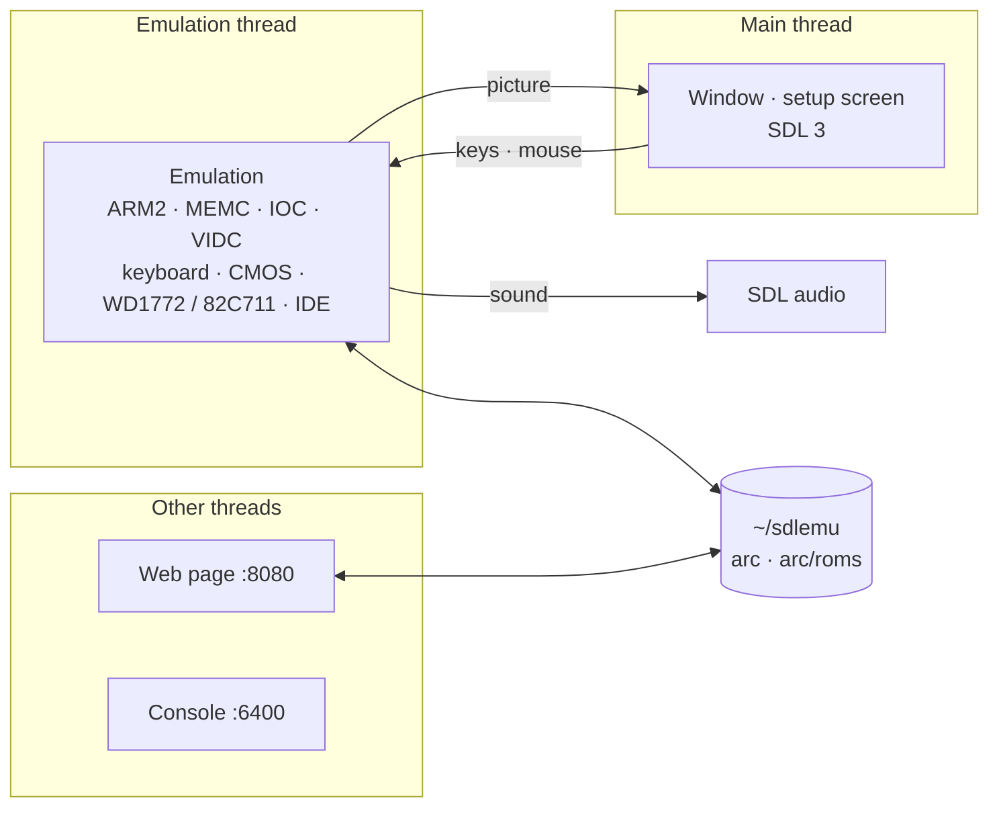

<h1 align="center">sdlarc</h1>

<p align="center">
  <b>An Acorn Archimedes in an SDL 3 window on Linux or macOS.</b><br>
  The A440 (ARM2 at 8 MHz) or the A3020 / A4000 (ARM250 at 12 MHz), MEMC, IOC and VIDC, up to 4 MB, Arthur 1.20, RISC OS 2.00 or RISC OS 3.11, two floppy drives and an IDE hard disc for disc images.
</p>

<p align="center">
  
  
  
  
  
  
</p>

<p align="center">
  <b>Work in progress:</b> not everything has been tested, and games and demos may or may not
  work satisfactorily.
</p>

<p align="center">
  
  
  <br>
  <sub>The desktops of RISC OS 3.11 and RISC OS 2.00, on the Pi.</sub>
</p>

sdlarc runs [esp32arc](https://github.com/rlucencic/esp32arc)'s Archimedes on 64-bit Linux (arm64 and amd64) and Apple Silicon macOS. SDL 3 provides the window, sound and input. The machine is the
same code as on the ESP32 boards: esp32arc's platform-independent core and
[esp32emu](https://github.com/rlucencic/esp32emu)'s CPU core, on
[sdlemu](https://github.com/rlucencic/sdlemu), the family's desktop runtime: a setup
screen in the window, sound, the host's keyboard and mouse, a web page on your network and a
console.

It belongs to the SDL desktop family of the ESP32 emulators:
[sdlzx](https://github.com/rlucencic/sdlzx) (ZX Spectrum),
[sdlcpc](https://github.com/rlucencic/sdlcpc) (Amstrad CPC),
[sdlcbm](https://github.com/rlucencic/sdlcbm) (Commodore 64 and 128),
[sdlcoco](https://github.com/rlucencic/sdlcoco) (Tandy Color Computer 2 and 3),
[sdlgs](https://github.com/rlucencic/sdlgs) (Apple IIGS),
[sdlmsx](https://github.com/rlucencic/sdlmsx) (MSX1 and MSX2),
[sdlxl](https://github.com/rlucencic/sdlxl) (Atari 800XL and 130XE),
[sdlste](https://github.com/rlucencic/sdlste) (Atari STE),
[sdlpc](https://github.com/rlucencic/sdlpc) (IBM PC/XT and PC/AT),
[sdlmac](https://github.com/rlucencic/sdlmac) (Macintosh Plus, SE, Classic),
[sdlmac2](https://github.com/rlucencic/sdlmac2) (Macintosh LC and II),
[sdlmac3](https://github.com/rlucencic/sdlmac3) (Macintosh LC II and LC III),
[sdlami](https://github.com/rlucencic/sdlami) (Amiga 500, 2000, 600, 1200).

## Features

**The machine**
- **ARM2**: a new core written for this project. It has the 26-bit PC and
  PSR in R15, the four modes and their banked registers, the exceptions,
  aborts and the ARM2's own quirks, and counts the machine's memory cycles
  (sequential, non-sequential, internal, slow ROM). As the A3020's
  **ARM250** it has SWP and runs at 12 MHz. Checked against 190
  hand-written cases and hundreds of thousands of random instructions
  compared with another ARM emulator
- **MEMC1a**: the page map with its protection levels (4 to 32 KB pages),
  video, pointer and sound DMA, the ROM speed. 512 KB, 1, 2 or 4 MB of
  RAM, each wired as the MEMC addresses it, so the OS finds the size itself
- **IOC**: interrupts, the four timers, the keyboard's serial link (with
  the keyboard's own microcontroller and the mouse behind it), the I²C
  clock and CMOS RAM (PCF8583)
- **VIDC1a**: every display mode the OS sets up (1, 2, 4 and 8 bits a
  pixel, 320 to 640 pixels across, TV and monitor timings), the palette,
  the 32-pixel hardware pointer; 8-channel logarithmic stereo sound. Each
  frame is copied out of RAM while it's shown, so games that flip between
  two screens show whole frames
- **A3020 / A4000**: the 82C711 (the floppy controller with high density
  discs, the IDE interface), the IOEB (VGA timings, the monitor's ID): the
  RISC OS 3.11 desktop at 640×480
- **Arthur 1.20, RISC OS 2.00 or RISC OS 3.11**, chosen on the setup screen.
  Each keeps its own CMOS RAM; a first start begins from the OS's own
  defaults with two floppy drives configured, straight into the desktop.
  The clock is set from the Pi's time
- **In real time** on the Pi (the desktops checked so far), with most of a
  core to spare

**Discs**
- **Two floppy drives** with a WD1772 at a real drive's pace: formatting,
  reading and writing as the OS does it
- `.adf` / `.adl` / `.img` images: ADFS E and D (800 KB), L (640 KB), M
  and S, DOS 720 KB; changed tracks are written back to the image
- **New blank discs** from the setup screen or the web page come ready
  formatted (ADFS E, 800 KB, called "Blank")
- **The A3020's IDE hard disc**: `.hdf` images; new ones of 40, 81 or
  162 MB come formatted for ADFS (as Acorn's HForm leaves them), as
  IDEDisc4 on the icon bar
- Discs changed while the machine runs are noticed, as on the real drive

**Around it**
- **A window** of its own on the Pi's desktop (X11 or Wayland), resizable, full screen
  with Ctrl+Alt+F; the picture in the machine's shape, smoothly scaled
- **Setup screen** in the window, first thing at start and any time with Ctrl+Alt+M:
  model, system, memory, menu button, the sound's volume, the drives and their images (insert, eject, new
  blank ones), Start / Back / Restart, Reset
- **The Pi's keyboard and mouse**: keys by position, as the boards' Bluetooth keyboards;
  a click in the window gives the mouse to the machine, Ctrl+Alt+G takes it back
- **Web page** at `http://<the Pi>:8080/`: drop images (or ZIP files) onto it, insert
  them, make blank ones, and watch the machine and its drives live
- **Sound** through SDL (PipeWire, PulseAudio or ALSA), the machine paced by the clock
- **Console** on the terminal and on `127.0.0.1:6400`: keys, typing, drives, screenshots

<p align="center">
  
  <br><sub>The setup screen in the window, before the Archimedes starts</sub>
</p>

## Getting started

### 1. What you need

- 64-bit Linux (including Raspberry Pi 5) or Apple Silicon macOS with SDL 3.2 or newer. See [desktop build dependencies](https://github.com/rlucencic/sdlemu#building).
- [esp32emu](https://github.com/rlucencic/esp32emu), [sdlemu](https://github.com/rlucencic/sdlemu)
  and [esp32arc](https://github.com/rlucencic/esp32arc), cloned next to this project
- The ROMs (below)

### 2. Build

```sh
git clone https://github.com/rlucencic/esp32emu.git
git clone https://github.com/rlucencic/sdlemu.git
git clone https://github.com/rlucencic/esp32arc.git
git clone https://github.com/rlucencic/sdlarc.git && cd sdlarc
cmake -S . -B build -G Ninja && cmake --build build
```

### 3. ROMs

Arthur 1.20's or RISC OS 2.00's (512 KB) or RISC OS 3.11's (2 MB) in the
data folder's `arc/roms/` (`~/sdlemu/arc/roms`), under any name (esp32arc's:
`arthur120.rom`, `riscos200.rom`, `riscos311.rom`): found by what it holds.
Not part of this repository.

### 4. First start

1. `build/sdlarc`: the setup screen opens in a window.
2. Choose the model and click **Start**.
3. Put images into `~/sdlemu/arc/`, drop them on the window or the web page, and
   insert them on the setup screen's **Disks** page.

## Using it

| To | Do |
|---|---|
| Get back to the setup screen | Ctrl+Alt+M (the machine waits meanwhile) |
| Full screen | Ctrl+Alt+F |
| Give the mouse to the machine, take it back | A click in the window; Ctrl+Alt+G |
| Run as fast as it goes (warp) | Ctrl+Alt+W, again for real speed |
| Take a screenshot | Ctrl+Alt+S (into `~/sdlemu/screenshots`), or the console's `s` |
| Insert an image | The setup screen's **Disks** page, drop it on the window or the web page, or name it on the command line: `build/sdlarc game.adf` |
| Start straight into the machine | `build/sdlarc -S`, with the setup screen's rows as `--choice`: `build/sdlarc -S --choice "System=RISC OS 2.00"` |
| Show the window on another computer | Log in with `ssh -C -Y <the Pi>` and start it there: fine for still pictures; games want the Pi's own monitor |
| Open a disc | Click its drive on the icon bar (:0 is the right-hand one) |
| Give the A3020 a hard disc | Web page: a new blank disc of 40, 81 or 162 MB, **Insert into… → IDE disc** |
| Get a command line | F12 in the RISC OS desktop |

Images live in `~/sdlemu/arc/`, settings in `~/.config/sdlemu/settings.ini`; the
inserted images are remembered across starts. `build/sdlarc --help` lists the options.

**Keyboard**: by position, as on the Archimedes' UK keyboard. Alt is Alt
(the Windows/⌘ keys too), Ctrl and Shift as themselves on both sides;
Backspace, Delete, Insert, Home, Page Up and Page Down as themselves; End
is Copy, Pause is Break, Print and Scroll Lock as themselves; F1-F12 and
the keypad (Num Lock, /, *, -, +, Enter; the keypad's = is its #).

## How it works



- **[esp32arc](https://github.com/rlucencic/esp32arc)'s `components/archimedes`**: the Archimedes,
  platform independent: the same code runs on the ESP32 boards.
- **`src/`**: the glue, esp32arc's `main/main.c` ported: memory, ROMs, settings, keyboard map,
  drives and status.
- **[sdlemu](https://github.com/rlucencic/sdlemu)**: the window, the setup screen, sound,
  input, the web page, the console, the data folder and the settings.
- **[esp32emu](https://github.com/rlucencic/esp32emu)**: the CPU core (ARM2).

## Development

```sh
../sdlemu/tools/pi.sh sdlarc build        # from another computer: sync to the Pi, build there
../sdlemu/tools/pi.sh sdlarc run          # its window on this computer (ssh -C -Y)
../sdlemu/tools/pi.sh sdlarc headless     # no window: drive it through the console
../sdlemu/tools/console.sh i 's /tmp/shot.png'
```

`CLAUDE.md` has the details: the layout, how it was ported, the checks; esp32arc's own
`CLAUDE.md` has the machine's.

## Limitations

- Checked on the Pi through its console and screenshots: RISC OS 3.11 and 2.00 at full speed to their desktops. Not yet by hand
  in the window, with the sound heard, or with much software.
- Over X forwarding (`ssh -Y`) every changed picture crosses the network: 8 to 15 a second.
- **Speed**: the latest measured Lander runs remain paced near 50 FPS on
  both models. At 360 MHz, machine frame calls average 12.96 ms on A440
  and 18.63 ms on A3020 against a nominal 20 ms frame budget. Runtime work
  outside those calls still needs time; these are averages for one game,
  not a guarantee for busier software. See the
  [optimization status and remaining work](https://github.com/rlucencic/esp32arc/blob/main/docs/optimization-status-2026-11-06.md)
  and [measured comparison](https://github.com/rlucencic/esp32arc/blob/main/docs/preindexed-transfer-experiment-2026-11-06.md).
  Slower software keeps its emulated clock and sound timing.
- Blank discs are ADFS E, which Arthur can't read: format one with
  Arthur's own `*Format` (D format) there.
- Lander plays no sound here: it asks the OS for none (whether the demo
  has any on a real machine isn't checked). The OS's own sounds (the beep,
  BASIC's SOUND) play.
- Copy-protected originals that need more than a sector image (`.adf`)
  can hold don't work: no `.apd`, `.jfd` or `.hfe` images yet.

## Credits

- [MAME](https://www.mamedev.org)'s Archimedes drivers (MEMC, IOC, VIDC1a,
  A310; by Angelo Salese, R. Belmont, Juergen Buchmueller, Sandro Ronco and
  Nigel Barnes), the reference for how the chips behave (read, not copied)
- [Arculator](https://github.com/sarah-walker-pcem/arculator) by Sarah
  Walker, the reference for the keyboard's protocol and the memory wiring
- [Unicorn](https://www.unicorn-engine.org), the ARM emulator the ARM2 core
  is tested against
- [SDL](https://libsdl.org) 3 for the window, the sound and the input

## Licence

[MIT](LICENSE).

Acorn, Archimedes, Arthur and RISC OS are trademarks of their owners. This
project contains no Acorn code; you need your own ROM images and software.
